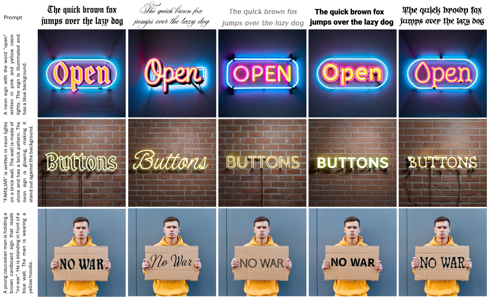

<div align="center">

# CRAFT & TIDE: Typography Evaluation Benchmarks

**Benchmarks for Font-Conditioned Image Generation**

<a href='https://arxiv.org/abs/2606.06066'></a>
<a href='https://e-nns.org/icann2026/'></a>
<a href='https://huggingface.co/papers/2606.06066'></a>
<a href='https://huggingface.co/datasets/maryanlup/CRAFT-TIDE'></a>


**Official benchmark release for FontFusion (ICANN 2026)**

</div>
<p align="center">
  
  <br><em>Same prompt, five target fonts: FontFusion renders the text in the font shown at the top of each column.</em>
</p>
---

We introduce **CRAFT** and **TIDE**, the first benchmarks specifically designed for **font-conditioned typography evaluation** in generative models. Released alongside the paper:

> **FontFusion: Enhancing Generative Text in Diffusion Models with Typographic Conditioning**
> Marian Lupașcu, Nipun Jindal, Ionuț Mironică, Zhaowen Wang — Adobe Research & University of Bucharest

| Benchmark | Full Name | Prompts | Avg. words/text | Focus |
|-----------|-----------|---------|-----------------|-------|
| **CRAFT** | Controlled Rendering Assessment for Font Typography | 1,605 | 1.29 | Precise font fidelity in minimalist layouts |
| **TIDE** | Typography In Design Environments | 100 | 4.19 (137 quoted texts) | Realistic multi-word design complexity |

## 🔥 Updates

* **2026-11-17**: Benchmarks available on [🤗 Hugging Face](https://huggingface.co/datasets/maryanlup/CRAFT-TIDE)
* **2026-09-14**: Presented at ICANN 2026 in Padova, Italy. See the [conference website](https://e-nns.org/icann2026/)
* **2026-06-04**: CRAFT and TIDE benchmarks released publicly
* **2026-05-29**: FontFusion accepted at ICANN 2026

## 📁 Files

```
benchmarks/
├── craft/
│   └── craft.txt       # 1,605 prompts, one per line
└── tide/
    └── tide.txt        # 100 prompts, one per line
```

Each line is a self-contained generation prompt. CRAFT prompts use short text segments in minimalist layouts for precise font fidelity measurement. TIDE prompts embed longer quoted texts in richer design contexts to test realistic complexity.

---

## 🚀 Evaluation Protocol

### Fonts

Font coverage spans the difficulty spectrum used in the paper:

| Font | Category | Difficulty |
|------|----------|------------|
| VivaStd-Bold | Geometric | Medium |
| Roboto-Black | Sans-serif | Medium |
| RigSans-Regular | Serif | Medium |
| CarolGothic | Decorative gothic | Hard |

### Metrics

**1. Character Accuracy (Char%)**
OCR-based character-level recognition rate on the generated text region, compared against the ground-truth string in the prompt.

**2. Word Accuracy (Word%)**
Word-level recognition rate. A word is correct only if all its characters are recognized correctly.

**3. FontCLIP Cosine Similarity**
Typographic fidelity via [FontCLIP](https://github.com/yukistavailable/FontCLIP). Cosine similarity between the FontCLIP embedding of the reference font glyph and the generated text crop. Higher = better font consistency.

```
Font Consistency = mean(FontCLIP_cosine_similarity(reference_glyph, generated_crop))
```

### Usage

```python
# Pseudocode
for prompt in benchmark_prompts:
    for font in evaluation_fonts:
        image = generate(model, prompt, font_conditioning=font)
        text_crop = crop_text_region(image)

        # OCR metrics
        char_acc = ocr_char_accuracy(text_crop, ground_truth_text(prompt))
        word_acc = ocr_word_accuracy(text_crop, ground_truth_text(prompt))

        # Font consistency
        ref_glyph = render_reference_glyph(font)
        font_sim = fontclip_cosine_similarity(ref_glyph, text_crop)
```

Results are reported as mean per font and as a global mean across all fonts.

---

## 📊 Results

### CRAFT

| Model | Global Word% / Char% | VivaStd-Bold | Roboto-Black | RigSans-Regular | CarolGothic |
|-------|----------------------|--------------|--------------|-----------------|-------------|
| FLUX.1 [dev] (base) | 72.31 / 80.14 | — | — | — | — |
| FLUX.1 [dev] + FontFusion | 71.44 / 79.87 | 77.89 / 85.12 | 78.34 / 85.91 | 77.56 / 85.03 | 59.12 / 73.28 |
| FLUX.1 Kontext (base) | 69.84 / 78.23 | — | — | — | — |
| FLUX.1 Kontext + FontFusion | 68.91 / 77.84 | 75.23 / 83.41 | 76.14 / 84.22 | 75.89 / 83.97 | 54.67 / 68.43 |

### TIDE

| Model | Global Word% / Char% | VivaStd-Bold | Roboto-Black | RigSans-Regular | CarolGothic |
|-------|----------------------|--------------|--------------|-----------------|-------------|
| FLUX.1 [dev] (base) | 69.17 / 77.43 | — | — | — | — |
| FLUX.1 [dev] + FontFusion | 68.84 / 77.12 | 74.12 / 82.33 | 75.44 / 83.12 | 74.87 / 82.78 | 56.34 / 70.15 |
| FLUX.1 Kontext (base) | 66.42 / 75.18 | — | — | — | — |
| FLUX.1 Kontext + FontFusion | 65.73 / 74.91 | 71.34 / 79.82 | 72.15 / 80.44 | 71.89 / 80.11 | 51.23 / 65.34 |

Font consistency (FontCLIP): FLUX.1 [dev] + FontFusion achieves **76.52%** vs. **0.91%** for the unconditioned base.

📄 Full results and analysis in the [arXiv paper](https://arxiv.org/abs/2606.06066)

---

## 📦 Requirements

* Python ≥ 3.9
* [FontCLIP](https://github.com/yukistavailable/FontCLIP) for font similarity
* Any OCR engine (PaddleOCR or Tesseract recommended)

---

## 📖 Citation

```bibtex
@inproceedings{lupascu2026fontfusion,
    author    = {Lupa\c{s}cu, Marian and Jindal, Nipun and Mironic\u{a}, Ionu\c{t} and Wang, Zhaowen},
    title     = {FontFusion: Enhancing Generative Text in Diffusion Models with Typographic Conditioning},
    booktitle = {Artificial Neural Networks and Machine Learning -- ICANN 2026},
    series    = {Lecture Notes in Computer Science},
    pages     = {40--52},
    publisher = {Springer},
    year      = {2026},
    doi       = {10.1007/978-3-032-38407-2_4}
}
```

---

## 🙏 Acknowledgments

* Evaluated on [FLUX.1 [dev]](https://github.com/black-forest-labs/flux) and [FLUX.1 Kontext](https://arxiv.org/abs/2506.15742)
* Font similarity via [FontCLIP](https://github.com/yukistavailable/FontCLIP)
* Compared against [FonTS](https://arxiv.org/abs/2412.00136) and [Glyph-ByT5](https://arxiv.org/abs/2403.09622)

---
